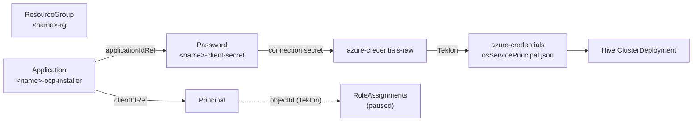

# fleet-cluster-scaffold

Standalone CLI tool for scaffolding OpenShift cluster overlay directories with Kustomize. Generates all the Hive and Crossplane resources needed to provision a cluster on AWS or Azure, without depending on the fleet monorepo.

## What it does

Given a cloud, cluster name, region, and tier, `fleet-scaffold-cluster` generates a complete Kustomize overlay directory containing:

- **Hive resources** -- ClusterDeployment, MachinePool, ManagedCluster, KlusterletAddonConfig, install-config Secret, and Namespace patches
- **Crossplane resources** -- per-cluster cloud credentials
  - AWS: installer IAM user, cluster-scoped IAM users for each OpenShift operator, and BYO node roles
  - Azure: ResourceGroup, Entra Application, ServicePrincipal, client secret, and RoleAssignments
- **Cluster metadata** -- `platform` and cloud-specific keys read by the fleet pipelines, plus optional values such as the htpasswd identity provider name

Each overlay references shared base resources in `cluster-templates/<cloud>/<topology>/` via relative paths, so clusters stay lightweight while sharing common definitions.

## Requirements

- Python 3.11+
- [kustomize](https://kubectl.docs.kubernetes.io/installation/kustomize/) (for post-scaffold validation; skip with `--skip-validation`)

## Installation

```bash
pip install .
```

This installs the `fleet-scaffold-cluster` command.

## Usage

```
fleet-scaffold-cluster CLOUD --name NAME --region REGION --tier TIER [options]
```

| Cloud      | Status              |
|------------|---------------------|
| `aws`      | Supported           |
| `azure`    | Supported           |
| `gcp`      | Planned (exits 1)   |
| `ibmcloud` | Planned (exits 1)   |

Run `fleet-scaffold-cluster CLOUD --help` for the full flag list of a cloud.

### Quick start

```bash
# AWS
fleet-scaffold-cluster aws --name my-cluster --region us-east-1 --tier base

# Azure
fleet-scaffold-cluster azure --name my-cluster --region eastus2 --tier base \
  --subscription-id 00000000-0000-0000-0000-000000000000
```

This creates `./my-cluster/` with the full Kustomize overlay structure and validates it with `kustomize build`.

### Common arguments (all clouds)

| Flag                       | Default                      | Description                                                  |
|----------------------------|------------------------------|--------------------------------------------------------------|
| `--name`                   | *(required)*                 | Cluster name (valid DNS-1123 label: lowercase alphanumeric and hyphens, 1-63 chars) |
| `--region`                 | *(required)*                 | Cloud region (e.g. `us-east-1`, `eastus2`)                   |
| `--tier`                   | *(required)*                 | Cluster tier: `base`, `virt`, `ai`                           |
| `--topology`               | `standard`                   | `standard`, `compact`, or `sno`; selects `cluster-templates/<cloud>/<topology>` |
| `--environment`            | `development`                | Environment label applied to ManagedCluster                  |
| `--base-domain`            | `openshiftpartnerlabs.com`   | Cluster base DNS domain                                      |
| `--control-plane-type`     | cloud-specific               | Instance type for control plane nodes                        |
| `--worker-type`            | cloud-specific               | Instance type for worker nodes                               |
| `--control-plane-replicas` | topology-specific            | `3` (standard, compact) or `1` (sno)                         |
| `--worker-replicas`        | topology-specific            | `3` (standard) or `0` (compact, sno)                         |
| `--image-set`              | `img4.21.13-x86-64-appsub`   | OpenShift ClusterImageSet name                               |
| `--zones`                  | cloud-specific               | Comma-separated zone list                                    |
| `--htpasswd-provider-name` | *(none)*                     | Display name for the htpasswd identity provider              |
| `--base-path`              | `.`                          | Parent directory for the cluster overlay                     |
| `--cluster-templates-dir`  | `cluster-templates`          | Path to shared cluster templates directory                   |
| `--force`                  |                              | Overwrite an existing cluster directory                      |
| `--skip-validation`        |                              | Skip `kustomize build` validation after scaffolding          |

### AWS

| Setting                     | Default                  |
|-----------------------------|--------------------------|
| `--control-plane-type`      | `m7i.4xlarge`            |
| `--worker-type`             | `m7i.2xlarge`            |
| `--zones`                   | `<region>a,b,c`          |
| `--legacy-mint-credentials` | off (rollback only, see below) |

```bash
fleet-scaffold-cluster aws \
  --name prod-east-01 \
  --region us-east-2 \
  --tier ai \
  --topology standard \
  --environment production \
  --control-plane-type m7i.8xlarge \
  --worker-type m7i.4xlarge \
  --worker-replicas 6 \
  --zones us-east-2a,us-east-2b \
  --htpasswd-provider-name "Acme Corp"
```

#### AWS credentials: cluster-scoped (default)

Partners get cluster-admin, and all clusters share one AWS account. So no credential that reaches a spoke may act on another cluster's resources. New AWS clusters therefore use:

- **`credentialsMode: Manual`**: the installer key is never copied to the spoke (no `kube-system/aws-creds`).
- **Ownership tag** `openshiftpartnerlabs.com/cluster=<name>`, set via install-config `userTags` and `propagateUserTags`, so the installer and the operators tag what they create.
- **One IAM user per OpenShift operator** (machine-api, image-registry, ingress, ebs-csi, cloud-network-config-controller, cloud-credential-operator read-only). Each policy is derived from the OCP 4.20/4.21 CredentialsRequests and limited to the cluster:
  - instances by the cluster's instance profiles;
  - volumes, snapshots, security groups and load balancers by the ownership tag (settable only at create time);
  - S3 by the infra-ID bucket prefix;
  - Route53 by `*.apps.<name>.<domain>`;
  - `iam:PassRole` by the cluster's own node roles.
- **BYO node roles** `<name>-{master,worker}-role` (install-config `iamRole`) with scoped policies. The AWS cloud-controller-manager runs on the master role.
- **Installer user** without `iam:*`: its IAM rights are limited to the cluster's roles and instance profiles. It stays on the hub, where cert-manager also uses it for Route53 DNS-01.

Policies are generated by `src/scaffold/providers/aws_policies.py`. The base is `cluster-templates/aws/<topology>/crossplane-scoped/`.

**Fleet pipeline contract** (`metadata.yaml`: `aws-credentials-mode: scoped`):
1. Wait for the Secrets `<name>-<operator>-credentials-raw` (keys `username`/`password`) written by the Crossplane AccessKeys.
2. Build Secret `<name>-cloud-credentials-manifests`. It holds one Secret manifest per operator, each with `aws_access_key_id`/`aws_secret_access_key` for that operator's target namespace and name (see `COMPONENTS` in `aws_policies.py`). The ClusterDeployment references it as `spec.provisioning.manifestsSecretRef`.
3. After Hive reports the cluster installed (before handoff), substitute `INFRA_ID_PLACEHOLDER` with `ClusterDeployment.spec.clusterMetadata.infraID`, and `VPC_ID_PLACEHOLDER` with the cluster VPC ID, in the cluster's Crossplane Policies and Roles. Until then the placeholders match nothing (fail closed). Afterwards:
   - resources tagged only `kubernetes.io/cluster/<infraID>=owned` are also treated as owned. machine-api, EBS CSI and the cloud-controller-manager always apply that tag at create time, so partner `LoadBalancer` Services work without annotations.
   - egress-IP ENI changes are limited to the cluster VPC.
4. The pipeline's ClusterRole needs `iam.aws.upbound.io` `roles`.

**Limits and residuals:**
- Cluster names can be at most 49 characters (IAM names `<name>-<operator>` are capped at 64).
- Between install and step 3, partner `LoadBalancer` Services and egress IPs are denied. Partners don't have access yet in that window.
- Custom operator policies are outside Red Hat's tested configuration. On every OCP minor upgrade:
  1. re-diff the CredentialsRequests (`oc adm release extract --credentials-requests --cloud=aws --included`) against `tests/fixtures/credentialsrequests/` and update `aws_policies.py`;
  2. set `cloudcredential.openshift.io/upgradeable-to` on the spoke.

**`--legacy-mint-credentials`** generates the previous Mint-mode overlay: the account-admin installer policy, with the key stored on the spoke. It exists only as a rollback while the scoped workflow is validated, and prints a warning.

### Azure

| Flag                           | Default             | Description                                              |
|--------------------------------|---------------------|----------------------------------------------------------|
| `--subscription-id`            | *(required)*        | Subscription the cluster is installed into (UUID)        |
| `--base-domain-resource-group` | `openshift-dns`     | Resource group holding the Azure DNS zone for `--base-domain` |
| `--cloud-name`                 | `AzurePublicCloud`  | `AzurePublicCloud` or `AzureUSGovernmentCloud`           |
| `--control-plane-type`         | `Standard_D8s_v5`   |                                                          |
| `--worker-type`                | `Standard_D8s_v5`   |                                                          |
| `--zones`                      | `1,2,3`             | The region must support availability zones               |

```bash
fleet-scaffold-cluster azure \
  --name dev-az-01 \
  --region eastus2 \
  --tier base \
  --topology compact \
  --subscription-id 00000000-0000-0000-0000-000000000000 \
  --base-domain-resource-group openshift-dns
```

#### Azure credential flow

Each cluster gets its own service principal, scoped to its own resource group:



| RoleAssignment            | Role                        | Scope                              |
|---------------------------|-----------------------------|------------------------------------|
| `<name>-contributor`          | Contributor                 | `<name>-rg`                        |
| `<name>-user-access-admin`    | User Access Administrator   | `<name>-rg`                        |
| `<name>-dns-zone-contributor` | DNS Zone Contributor        | `--base-domain` zone in `--base-domain-resource-group` |
| `<name>-reader`               | Reader                      | Subscription (installer validation, read-only) |

The installer installs into the pre-created, empty `<name>-rg` (`platform.azure.resourceGroupName`).

**The fleet Tekton pipeline must complete two steps** (Crossplane cannot do them with plain managed resources, because `provider-azure` RoleAssignments cannot reference a `provider-azuread` Principal):

1. For each `RoleAssignment` in the cluster namespace: set `spec.forProvider.principalId` to the Principal's `status.atProvider.objectId` and remove the `crossplane.io/paused` annotation.
2. Build Secret `azure-credentials` with key `osServicePrincipal.json`:
   ```json
   {
     "subscriptionId": "<--subscription-id>",
     "clientId": "<Application status.atProvider.clientId>",
     "clientSecret": "<azure-credentials-raw key attribute.value>",
     "tenantId": "<Principal status.atProvider.applicationTenantId>"
   }
   ```

If the overlays are synced by a GitOps tool, exclude `spec.forProvider.principalId` and the paused annotation on RoleAssignments from drift detection, or the sync will revert step 1.

#### Azure hub prerequisites

- Crossplane providers `provider-azure-azure`, `provider-azure-authorization`, and `provider-azuread`, each with a `ProviderConfig` named `default`
- The provider identity needs Entra permission to create app registrations (e.g. `Application.ReadWrite.OwnedBy`) and Owner (or Contributor + User Access Administrator) on the subscription
- A public Azure DNS zone for `--base-domain` in `--base-domain-resource-group`
- Regional vCPU quota for the chosen VM family

## Generated directory structure

```
<cluster-name>/
  kustomization.yaml            # aggregates hive/ and crossplane/
  metadata.yaml                 # platform, cloud-specific pipeline keys, htpasswd provider name
  hive/
    kustomization.yaml           # references cluster-templates/<cloud>/<topology>/hive
    patches/
      clusterdeployment.yaml
      install-config.yaml
      install-config-meta.yaml
      klusterletaddonconfig.yaml
      machinepool-worker.yaml    # standard topology only
      managedcluster.yaml
      namespace.yaml
  crossplane/
    kustomization.yaml           # references cluster-templates/<cloud>/<topology>/crossplane[-scoped]
    patches/
      ...                        # AWS scoped: installer/, node-roles/, <operator>/
                                 # AWS legacy: user, policy, policy-attachment, access-key
                                 # Azure: resource-group, application, service-principal,
                                 #        client-secret, role-assignment-*
```

## Cluster templates

The `cluster-templates/` directory contains shared base resources organized by cloud provider and topology:

```
cluster-templates/
  aws/      {standard,compact,sno}/{hive,crossplane-scoped,crossplane}   # crossplane/ = legacy Mint mode
  azure/    {standard,compact,sno}
  gcp/      {standard,compact,sno}   # templates only; no generator yet
```

## Adding a cloud provider

1. Add `cluster-templates/<cloud>/{standard,compact,sno}/{hive,crossplane}`.
2. Implement a `Provider` subclass in `src/scaffold/providers/<cloud>.py` (see `aws.py` and `azure.py`).
3. Replace the `PlannedProvider` entry in `src/scaffold/providers/__init__.py` with an instance of it.

## Validation

By default the tool runs `kustomize build` on both the `hive/` and `crossplane/` subdirectories after scaffolding. If validation fails the tool exits with code 1 and prints the kustomize error. Use `--skip-validation` to bypass this step (e.g. when kustomize is not installed or the cluster-templates bases are not present locally).

If the target cluster directory already exists, the tool refuses to overwrite it unless `--force` is passed.

## Development

### Running tests

```bash
pip install tox
tox
```

Or directly with pytest:

```bash
pip install pytest
pytest tests/ -v
```

### Linting

The project is configured for pylint and bandit (see `pyproject.toml` for rule settings).
